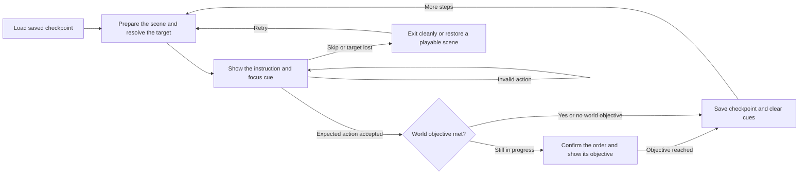

# ACIES tutorials and a reusable RTS onboarding specification

ACIES 2.5.1 has seven campaign entries and thirteen in-context tutorial categories. The campaign scripts run in the battle maps. The in-context scripts run over the actual lobby and battle UI. Both can show guidance, but they advance on different events and save different checkpoints.

The campaign catalog, written instructions, feature gates, and script structures below come from the shipped Android assets and ARM64 client. The visual analysis uses existing physical Pixel and OnePlus N100 captures of the first lesson. Later lessons and all thirteen in-context categories were inspected statically. Exact animation curves, sound cue names, and all branch outcomes were not verified on hardware.

## How ACIES starts and saves training

- The title reads the number of entries in `account.campaignStages`. If it is below the required count, the client loads the campaign entry at that zero-based index in offline mode 32. The shipping count is **four**, including the opening. Campaign victories and explicit campaign-step requests can update this array. The client's first captured result used one-based `campaignStage: 1` for the opening. [Title and result flow](acies-login-flow.md#what-happens-after-guest-sign-in)
- A lobby tutorial uses an independent saved step per category. `Tutorial::start` starts from that category's saved step when it is below the number of authored steps. The client normally asks the backend for the next step and waits for a response. The response updates the player state and can apply rewards. Restart recovery is at a step boundary. The line currently executing inside a step is transient. [Protocol fields](acies-json-payloads.md) · [Native symbols](../decrypts/libcdkapp/symbols.demangled.txt)
- The original client derives feature gates from category 0. Its lessons have minimum account levels, and completing the matching lesson advances the saved step **past** the feature's threshold. When the client loads an account already past a threshold it initializes the flag quietly. When an in-session step update crosses a threshold it can emit the unlock notice. [Native symbols](../decrypts/libcdkapp/symbols.demangled.txt) · `menu.xmf` at decoded `0x16e957`
- The local Community service uses a three-stage counter and emits an extra available campaign slot when that count is reached. That four-entry array satisfies the client's length check even when Tutorial 3 has not been played. The service also marks the old lobby walkthrough complete after that point so it can bypass dependencies on the original shop. Treat the Community path as a preservation shortcut when reproducing the original sequence. [Community server](../tools/acies_mock_server.py) · [Community deployment behavior](acies-community-deployment.md)

| Feature | Minimum account level for its lesson | Category 0 threshold | First saved value that opens it |
| --- | ---: | ---: | ---: |
| TV | 3 | 5 | 6 |
| Team Battle | 4 | 6 | 7 |
| Clan | 5 | 7 | 8 |
| Rune | 6 | 8 | 9 |
| Advanced strategies | 7 | 11 | 12 |

Native anchors are `TitleLayer::doComplete` at `0x7b76c0`, `Account::isPlayingCampaignTutorial` at `0x5fc57c`, `Account::Account` at `0x5f8490`, and `LobbyGateway::receiveTutorialStep` at `0x529c38`. The campaign table starts at decoded `menu.xmf` offset `0x10d078`. The byte immediately after those seven records is `04` at `0x10d9ba`; `Asset::loadMenu` stores it where the account check reads it. [Native symbols](../decrypts/libcdkapp/symbols.demangled.txt) · [Menu asset layout](acies-cdk3-xmf-reverse-engineering.md)

## The seven campaign and training scenarios

The map paths are `maps/map[003][NNN][001].xmf` for indices 000 through 006. Campaign list selection checks that the row exists in account progress, then checks any feature flag listed for that campaign record. The title automatically starts rows 0–3 during first-time onboarding. Rows 4–6 are advanced lessons with additional gates.

| Map index | Shipped title and entry requirement | What the player does or sees | Evidence in the decoded map |
| --- | --- | --- | --- |
| 000 | Tutorial Opening. First account entry. | Watches a directed battle vignette. The script reveals forces, pans and zooms, gives scripted commands, plays effects, and exposes skip at authored points. The client's first campaign completion observed on hardware is this opening. | 138 trigger instructions. No inline English speech recovered. Inspect `control`, `command`, `vision`, `scroll`, `zoom`, `animation`, and `skip_ready`. |
| 001 | Tutorial 1. After the opening. | Learns Swordsman selection with Troops, single-tap Move, and double-tap Attack Move. The lesson provides the squad, exposes a marked destination, introduces two Hounds and a Gnoll, then asks the player to defeat them. A closing line explains that the control scheme can be changed in settings. | 107 triggers. Main teaching sequence is group 2, lines 9–69. |
| 002 | Tutorial 2. After Tutorial 1. | Learns the economy with six provided Goblins. Double-taps to select the same unit type, sends workers to minerals, trains more at the Castle, places a Barracks, summons infantry, builds a Refinery, summons Archers, uses the minimap, and destroys the enemy Castle. The copy describes ten Goblins as an efficiency target. Several branches teach the appropriate button or prerequisite depending on the current state. | 535 triggers. Group 4 is the main sequence. Groups 7–16 contain resource, construction, summoning, and movement guidance. Group 21 teaches the castle attack. |
| 003 | Tutorial 3. After Tutorial 2. Final required campaign entry. | Trains three combat interactions in order. Select Snipers, activate Headshot, and select an Imp. Select Pyromancers, attack-move, and activate Explosion. Then use targeted spells including Poison and Blizzard to finish the remaining enemies. | 344 triggers. Groups 3, 5, and 7 are the three lessons. Groups 10–12 contain encounter checks and completion. |
| 004 | Rune Tutorial. Requires the Rune feature flag. | Starts with supplied units, buildings, and resources. Places a Mana Extractor at a designated point, develops or activates Blink, selects the troops, and aims Blink at a marked point. The lesson explains how tiered rune buildings relate to active and passive runes. | 197 triggers. Groups 3–6 contain the intro, building, development, and use sequences. |
| 005 | Drag Setup & Multi-Targeting Attack. Requires Advanced strategies. | Holds Troops while dragging to select a subset of Snipers. Holds Troops while activating Headshot and touches three enemy units in order. The explanation generalizes the modifier to other abilities and multiple building placements. | 117 triggers. Group 3 explains the technique. Groups 4–5 specify the inputs. |
| 006 | Squad Setup & Release. Requires Advanced strategies. | Double-taps Gnolls, assigns them through Squad Setup to slot 1, selects Shadow Fighters and assigns them to slot 2, issues different attack-move orders, and drags the Gnoll slot out to clear it. | 163 triggers. Groups 4–5 assign groups, 6–7 issue commands, and 8 releases a slot. |

Counts are the number of archived trigger instructions, including setup, branches, cleanup, and reused subroutines. They are not player-facing step counts. The advanced feature requirements are the native IDs `[3]`, `[4]`, and `[4]` stored in the campaign entries. The client checks those IDs against its five derived feature flags. [Map decoder](../tools/decode_acies_map.py) · [Native symbols](../decrypts/libcdkapp/symbols.demangled.txt)

### What a complete step looks like in the first lesson

| Beat | What appears | What actually advances it |
| --- | --- | --- |
| Preview | A wide briefing card shows the instructor, Swordsman, and two visually different order markers. The Move card is green and the Attack Move card is orange-red. | A two-second authored wait appears before each opening briefing beat, followed by runtime action and dialogue handling. |
| Select | The outer battlefield is darkened, the friendly squad is readable, and the real Troops button gets a cyan halo and white bracket marks. A compact top prompt names the button and highlights the word Troops in cyan. | The map sets control state for the target control, spawns the UI animation, and waits on a map action. On the physical client the cue changes after selection and green confirmation appears on the control and units. |
| Move | A world target shows where to order the squad. The briefing depicts this marker in green. The camera helps put the destination on screen and the top hint tells the player which input to use. | The script creates a destination effect and constrains the relevant command. It waits on the map action, then separately checks the encounter condition. The target effect is removed as the sequence advances. |
| Attack Move | A separate target and a short explanation introduce the attack-move gesture. The briefing depicts this marker in orange-red. The script reveals the enemy encounter so the player sees movement turn into combat. | The map installs a distinct command gate, waits for the appropriate action, removes the cue, then waits for enemy destruction before the closing speech and mission completion. |

Native trace for the selection beat is group 2, lines 18–26. For Move it is lines 28–39. For Attack Move it is lines 43–68. The `action`, `is_encountered`, and `is_destroyed` triggers are different checks. This distinction matters because a player can perform the right gesture without the selected units successfully reaching their destination or defeating the objective. [Selection before input](../work/community-local/onboarding-pixel-live.png) · [Confirmed selection](../work/community-local/onboarding-pixel-action.png) · [Briefing card](../work/community-local/accounts-n100-switched-to-incomplete.png) · [Map decoder](../tools/decode_acies_map.py)

## What creates the guidance

| Layer | ACIES evidence | Requirement for a new game |
| --- | --- | --- |
| Briefing art | A wide strip with character art presents the action vocabulary. The objective, unit, and command cards use distinct illustrations and concise captions. The battle map remains visible behind the modal panel. | Use one original illustration for each new verb. Give the player a visual preview that matches the real marker and HUD icon they will use. Allow the player to advance after reading. |
| Speaker and dialogue | Map speech accepts a portrait asset ID, localized speaker and body text, and optional substitutions. On the Pixel the unit portrait overlaps the edge of an amber bottom dialogue box, with a separate name label and progressively revealed text. The client also supports smaller world-unit speech bubbles. | Provide transparent portraits, a scalable dialogue frame, a speaker label, localized text, and a finish-reveal/advance action. Keep modality explicit. |
| HUD focus or “hover” | On the touch client this is authored focus. A step can emphasize a live UI layer and attach a timed animation or callout to it. The first lesson shows a cyan halo around a real button, with no pointer-hover input required. | Resolve the actual live control by stable identifier and re-anchor after layout. A ring or finger animation should draw attention without changing the hitbox. For mouse and controller, use appropriate glyph variants and show real focus where available. |
| World focus | Campaign scripts can scroll or zoom the camera, change visibility, and add or remove effects at a point, unit, or resource. Captures show a bright area around the squad against darker surroundings. | Give world and HUD targets distinct coordinate spaces. Let a world marker follow its object or tile, and bring an off-screen target into view or mark the appropriate edge. Keep the rest of the map dim enough to direct attention while remaining legible. |
| Gesture demonstration and confirmation | Native overlay animations take an asset ID, a layer, offset, and alignment. Campaign text and controls distinguish tap, double-tap, hold-plus-drag, and repeated targeting. The first selection shows success rings on the units. | Provide original reusable animations for tap, double-tap, hold, drag, and repeated targets. Confirm the accepted action separately from the next instruction. Include a stationary alternative for reduced motion. |
| Hint text and emphasis | The first lesson combines a compact dark text plate, bright body text, and highlighted action keywords. Map mission messages are added and removed by ID. A later explanatory line can replace the prompt without restarting the mission. | Separate the task, hint, and feedback strings. Use color plus icon or shape to communicate meanings. Resize for long strings, keep the callout away from its target, and avoid presenting two competing primary instructions. |
| Secondary effects | The map script has explicit sound, announcement and vibration instructions. The exact presentation of every cue was not measured. | Author optional sound and haptics as supplementary feedback for show, success, and skip. The lesson must be fully understandable with both disabled. |

Useful native anchors are `Map::mtSpeech` `0x57e90c`, `Map::mtSpeechBubble` `0x57eab0`, `Map::mtEffect` `0x57e0f0`, `Map::mtMission` `0x57fa3c`, `Map::mtControl` `0x57fd08`, `Map::mtAction` `0x5814a0`, `Tutorial::ttAnimation` `0x5f1330`, and `Tutorial::onDraw` `0x5edf1c`. [Native symbols](../decrypts/libcdkapp/symbols.demangled.txt) · [Portrait dialogue capture](../work/community-local/onboarding-pixel-stage1.png)

The first lesson's map provides a concrete art and VFX handoff. Group 2 starts two briefing animation assets `(0,15,35)` and `(0,15,29)` at lines 0 and 3. Line 22 starts HUD animation `(0,15,22)` during the Troops prompt. Lines 30 and 53 use different world effects at the Move and Attack Move destinations, `(0,15,15)` and `(0,15,14)`. The instructor dialogue at lines 9, 10, and 67 uses portrait `(3,16,4)`. These IDs identify the source assets. Recreate the role and motion of each cue with original characters, icons, and effects for your game. [Map decoder](../tools/decode_acies_map.py) · [Native symbols](../decrypts/libcdkapp/symbols.demangled.txt) · [Selection capture](../work/community-local/onboarding-pixel-live.png)

### Capture references and atlas export

The VFX tab indexes all **1,962** top-level records in `animations.xmf`, which includes interface art, unit animation, and visual effects. **1,955** entries have a browser render program. The seven records without a program comprise one timing record, one framebuffer lens, and five interface callbacks. The tab links 41 animations to trigger lines across all seven campaign tutorials and includes all seven dialogue portraits referenced by their speech commands. The speech fields point to subimages in `images[003][016].xmf`, as confirmed by `GameLayer::onDrawSpeech` at `0x6129b8`. [Source inventory](../decrypts/animations.xmf.summary.json) · [Exporter](../tools/build_acies_vfx.py)

The in-game gallery documents Tutorial Opening on a physical Pixel and Tutorial 1 on a OnePlus N100. The N100 stills use its 1600 × 720 landscape view. The edited clip follows the portrait dialogue, Troops focus, Move, and the Attack Move prompt. Later tutorials are mapped from their packaged scripts and art. [In-game gallery](http://127.0.0.1:8876/?view=vfx#vfx-captures) · [Portrait gallery](http://127.0.0.1:8876/?view=vfx#vfx-portraits)

| Cue | Visual handoff from the physical capture |
| --- | --- |
| Briefing | Large three-card strip over the dimmed battle map. Pointing instructor art and short headings establish the gesture and marker before the player uses them. |
| Troops focus | Cyan halo and white brackets pulse around the live button. The bright part of the map centers on the friendly squad. Cyan text in the top prompt names the active control. |
| Selection | Green circles appear beneath the Swordsmen. The Troops icon returns to its normal style with a green selection border and the top instruction advances to Move. |
| Move | A green ground ring, rising light, and a separate floating reticle center on the destination. The top instruction asks for one touch. |
| Attack Move | An orange-red ground ring and outward-pointing wedges surround the same type of floating reticle. Nearby enemies are visible and the instruction explicitly asks for a double touch. |

The reusable hand pointer is animation `0/15/0`. The Squad Setup & Release map uses it in group 4, line 14 and three later beats. Its texture and animation are available in the web player. [Hand pointer preview](http://127.0.0.1:8876/?view=vfx&effect=0%2F15%2F0)

**Battlefield** projects the effects using Tutorial 1’s 30° field of view, 42° tilt from vertical, 2,000 game-unit camera distance, and 1.5× zoom. The camera parameters come from `map[003][001][001].xmf` and the `Camera::Camera` and `Camera::applyImpl` routines at `0x5cab50` and `0x5cae9c`. The backdrop is a crop of the N100 Troops capture with the HUD and prompt cropped away. **Isolated** shows sprite and particle artwork on an adjustable background. Preview playback starts on a sampled visible frame and dark source art can open on a light background. [Battlefield preview](http://127.0.0.1:8876/?view=vfx&effect=0%2F15%2F15&camera=battlefield) · [Camera projection](../tools/acies_atlas/vfx-scene.js)

The preview combines original textures and meshes with reconstructed sprite timing, transforms, and particle emission. Sprite frame intervals follow `CSSprite::duration` at `0x7e4c1c`. Speed-based motion uses the distance between the local path endpoints divided by the authored speed, following `CSAnimation::positionDuration` at `0x7dd66c`. Mesh lighting is approximate. Trails and chains follow a sample path in the viewer. Runtime masks, shader effects, and gameplay targets can change the original result. Use the physical-phone captures to compare the preview with native world scale and cue placement. [Browser player](../tools/acies_atlas/vfx-player.js)

Build the atlas with the extracted APK and optional local capture folder. Omit `--include-audio` if the extracted audio is unavailable. Use `--include-vfx` in place of `--vfx-captures` to export the full catalog without phone footage.

```sh
uv run --no-project --python 3.12 --with pillow --with texture2ddecoder \
  python tools/build_acies_atlas.py --include-audio --vfx-captures work/atlas-vfx-capture
python3 tools/serve_acies_atlas.py --bind 127.0.0.1
```

The optional capture folder accepts `briefing`, `dialogue`, `focus`, `selection`, `move`, `attack`, and `opening` as WebP or PNG files and `tutorial-controls.mp4` as the clip. The exporter also generates the Battlefield backdrop from `focus.png` or `focus.webp`. The generated site uses `vfx/catalog.json`, on-demand effect and mesh JSON files, lossless WebP sprite crops, and browser-ready captures under `work/acies-atlas/vfx/`. [Local capture source](../work/atlas-vfx-capture/) · [VFX tab](http://127.0.0.1:8876/?view=vfx)

## The thirteen in-context categories

The category array has 30 step slots, with two empty slots. The names below describe the scripts and their native entry points. The original array stores localized dialogue and skip prompts in each category. The separate feature array supplies the localized unlock labels.

| ID | Step slots | Entry and topics | Decoded menu offset |
| ---: | ---: | --- | --- |
| 0 | 13 | The lobby starts or continues progressive onboarding. It covers the starter reward, deck, shop, ranked play, TV, Team Battle, Clan, runes, and advanced combat over several account levels. | `0x170117` |
| 1 | 1 | Opening the game mode selection teaches the ability to play freely without ranked stakes. | `0x1795bd` |
| 2 | 1 empty | Reserved category. The shipped step contains no instructions. | `0x1799c2` |
| 3 | 1 empty | Reserved category. The shipped step contains no instructions. | `0x1799c5` |
| 4 | 1 | Opening the Store shows recommended products, card fragments and refresh, cosmetics, miscellaneous products, chests, currencies, mileage, and packs. | `0x1799c8` |
| 5 | 1 | Opening Events introduces the event and reward menu. | `0x17d6be` |
| 6 | 1 | Opening Rankings introduces rankings and season rewards. | `0x17daae` |
| 7 | 1 | Opening Profile shows decorations and battle records, plus where to change name and country. | `0x17de90` |
| 8 | 1 | Opening Social explains managing friends, friendly games, and spectating with friends or clan members. | `0x17edaa` |
| 9 | 1 | Opening the Mailbox teaches notices and claiming mail rewards. | `0x17f3c5` |
| 10 | 1 | Opening Chat introduces chat channels, direct messages, clan channels, and search. | `0x180055` |
| 11 | 6 | Lobby and previous-result handlers can start defeat and comeback guidance. The lessons encourage another attempt, show card-and-gold upgrades, and present replay review as a learning tool. | `0x182e6b` |
| 12 | 1 | Opening Rune Draw explains silver and gold runes, fragments, mileage, and badge or jewel payments. | `0x184c98` |

### Progressive lobby onboarding, category 0

| Saved step at entry | Authored lesson and requirement |
| ---: | --- |
| 0 | Finish the basics of battle. The lobby dialogue describes a starter reward of Swordsman, Archer, and Crystals and introduces deck improvements. |
| 1 | Learn the eight-slot deck and two-spell limit. Equip Fireball, upgrade Swordsman, and inspect proficiency and decorations. |
| 2 | Use Crystals to buy missing Archer fragments. This sequence expects the old store transaction and its callback. |
| 3 | At account level 2, continue the general menu interaction and wait sequence. This slot has an authored skip prompt. The exact button targets are unresolved. |
| 4 | Introduce Battle and ranked 1v1. The dialogue previews the later team lesson. |
| 5 | At account level 3, demonstrate TV, live games, and recent replays. |
| 6 | At account level 4, demonstrate team games with friends and clan members. |
| 7 | At account level 5, explain joining or creating Clan, communication, friendly matches, and Clan Match Battle rewards. |
| 8 | At account level 6, introduce activation of the Rune feature and its reward. |
| 9 | Equip a rune and learn how to upgrade it. The script also requests one-based campaign step 5, the Rune Tutorial entry. |
| 10 | A text-free UI interaction and wait. The exact targets are unresolved. |
| 11 | At account level 7, introduce advanced combat. The script also requests one-based campaign step 7, extending access through the last advanced entry. |
| 12 | A text-free interaction. At saved step 13 the category is finished. |

Category 11 uses three pairs of steps. Steps 0–1 present a first defeat and suggest upgrading in Deck. Steps 2–3 present another setback and suggest watching a battle replay in Profile. Steps 4–5 give encouragement to try again. In the pending previous-result onboarding state, the lobby chooses category 11 when the server returns `defeat: true` and category 0 otherwise. The even steps skip their guidance if either solo or team division is at least 2. The branch is numeric, and the original server's timing for the defeat flag remains unresolved. [Native symbols](../decrypts/libcdkapp/symbols.demangled.txt) · `LobbyLayer::doGamePrevRsultComplete` at `0x63eda8` · `menu.xmf` at decoded `0x182e6b`

### How the in-context script advances

The category has skip ranges followed by a counted list of steps. Each step contains ordered instruction blobs that start with an opcode. Skip ranges are start-inclusive and end-exclusive. The main lobby allows the authored skip at step 3. Store, Mail, Chat, and Rune Draw each declare a skip range covering step 0. `Tutorial::run` interprets local operations until it reaches a wait, user input, gateway callback, checkpoint, or error.

| Opcode | Authored operation |
| --- | --- |
| `00`, `01` | Wait for the target UI layer or a screen touch. |
| `02`, `03` | Wait on a gateway response or send a UI event. |
| `04`, `05`, `06`, `07` | Emphasize a layer, draw an anchored animation, show an anchored message, or show portrait dialogue. |
| `08`, `09`, `0a` | Evaluate an account prerequisite, wait for a duration, or jump to a line. |
| `0b`, `0c`, `0d`, `0e` | Request the next tutorial step, show an error, record analytics, or request a campaign step. |

Native entry points include `TutorialCategoryData::skip` at `0x553f64`, `Tutorial::start` at `0x5ece78`, and `Tutorial::run` at `0x5edc20`. The dispatch table begins at `0x3b406d`. The runtime starts these short lessons from the actual screen's link callback, with the main and defeat categories also reachable through lobby events. Connecting cues to the actual screen lets the player practice the real interaction, but it also means a missing target control or backend callback must have an explicit recovery path. [Native symbols](../decrypts/libcdkapp/symbols.demangled.txt) · [Local walkthrough failure evidence](acies-local-mock-backend.md)

## Implementation requirements for your games



1. **Author each lesson around a completion predicate.** A step declares a stable ID, prerequisites, scene setup, allowed actions, target, cue, accepted semantic event, success cue, failure behavior, and a checkpoint. Keep gesture recognition, command validity, and success criteria independent. A move lesson should distinguish `MoveOrderAccepted` from `SquadReachedZone`. A build lesson should distinguish opening the build menu, accepting a placement, and completing construction.
2. **Use a real sandbox scenario.** Spawn a known squad, fill resource counts intentionally, provide target and fallback objects, set visibility and camera, and constrain only the actions that would invalidate the lesson. Keep Pause, accessibility settings, and Exit available. Release every restriction and temporary effect when the step ends, skips, or gets cancelled.
3. **Separate focus from input.** Give each action a HUD anchor, world anchor, or full-screen anchor. Use the same targeting API players use normally. Decorative overlays should not consume input, and blocking tutorial states should route only to approved game actions. A controller, remapped keyboard, or alternate touch layout should satisfy the same semantic event.
4. **Define cue lifecycle.** Show the instruction and cue together. Hold the cue until success or intentional dismiss. Use an optional reminder after idle time, without advancing from elapsed time. On accepted input, stop the pointing loop and show success feedback. If the objective still needs work, replace it with a relevant status cue. Validate that a cue vanishes when the target disappears or the view changes.
5. **Persist checkpoints by player and lesson.** Track campaign progress, inner tutorial step, optional lessons, unlocks, and reward delivery independently. Keep state monotonic and make requests idempotent. A retry or restart should restore the saved checkpoint without applying another reward or replaying unlock notices. Treat feature availability as state and its congratulatory toast as a one-time transition.
6. **Provide recovery.** If the expected control never appears, re-resolve it when the screen is ready, offer a retry or skip where permitted, and log the failed checkpoint. If a unit is destroyed or an opportunity is missed, respawn/reset a playable checkpoint or explain the failure. Remove cues and restore the previous input policy on every exit path.
7. **Use a hierarchy of optional lessons.** Finish initial training with the shortest path to a meaningful game outcome. Teach additional UI when a feature becomes relevant or the player explicitly invokes Help. Add a practice list with completed and repeatable lessons. Carry optional progress across devices and make onboarding tests use fresh accounts.

### Example step for a different RTS

| Field | Example |
| --- | --- |
| Step ID | `orders.move_to_rally` |
| Entry | The player has selected at least one allied scout in a fenced training area. |
| Instruction | “Send your scouts to the beacon.” |
| Focus | Show a world-space beacon and a small pulse around the target zone. Keep selection visible. |
| Allowed input | Inspect, select, pan, and issue Move to a legal position. |
| Accepted event | A move order for the selected scouts targets the zone. Replace the pointer with order confirmation. |
| Complete when | At least one designated scout enters the zone. Play a short confirmation and save the checkpoint. |
| Incorrect input | Explain a blocked destination once. Keep the step active. Offer a reset if the scouts become unavailable. |
| Accessibility | Label the beacon in text, differentiate the Move marker by shape, and replace repeated motion with a static outline in reduced-motion mode. |

### Acceptance tests

| Scenario | Pass condition |
| --- | --- |
| Start a new account and a returning account on the same device | The new account enters its first required lesson. The returning account restores its own checkpoint or opens the lobby. |
| Switch account, restart, or reconnect after an unlock | Availability is correct for the signed-in account. An acknowledged unlock and reward do not recur. |
| Tap elsewhere or issue the wrong command | The tutorial continues showing the appropriate target. The incorrect action does not complete the step. |
| Correct command succeeds, then pathing stalls | The order is acknowledged, but the arrival checkpoint does not finish. A recovery action is available. |
| Hold and drag, cancel, or repeat a double-tap near its threshold | The animation and completion logic agree with the actual gesture recognizer. No stale overlay or synthetic input remains. |
| Change resolution, UI scale, locale, or input device during a step | The cue follows the live target, text wraps without covering it, and the same gameplay action can still complete the step. |
| Skip, lose a unit, close a menu, or disconnect while a request is pending | The step retries or exits with clean camera, input, and cue state. No duplicate completion or reward is written. |
| Disable motion, sound, or haptics | Prompts, target location, input, and success remain distinguishable. |

## Reproducing the campaign inventory

The relevant bundle is Android ACIES 2.5.1. The encrypted menu asset SHA-256 is `e18365269e5cc3bca0b7e5bc3036f0287c939d2601ad7389879d0058d21f1972`. The ARM64 native client SHA-256 is `38a37aa8e270015b6c766744763b75c638829edf09373498a11fdf5de33e9ddd`.

```sh
python3 tools/decode_acies_map.py acies-apktool/assets/maps/map\[003\]*.xmf \
  --out-dir work/tutorial-research/maps
```

Use the emitted `triggers.csv` to identify map, group, line, byte offset, operation, and available decoded operands. The underlying records are also available in the seven JSON files. The campaign directory in the decrypted menu is a counted list of four little-endian 16-bit asset indices, a localized title, a reward item array, and a counted list of 16-bit feature IDs. The next byte is the mandatory campaign length. The lobby feature records and category programs begin at decoded offsets `0x16e957` and `0x170116` respectively. [Map decoder](../tools/decode_acies_map.py) · [Menu decoding reference](acies-cdk3-xmf-reverse-engineering.md)
